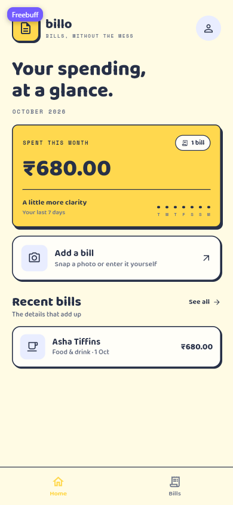
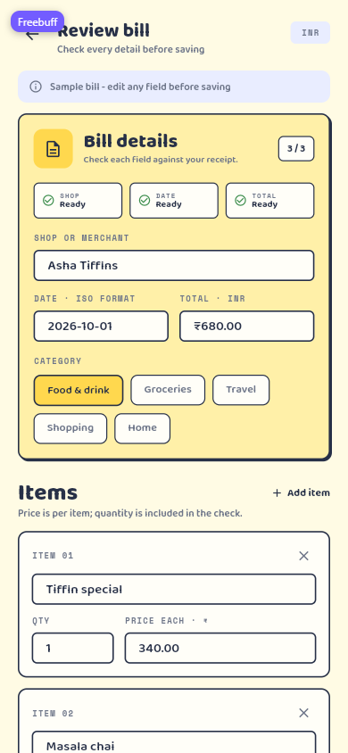
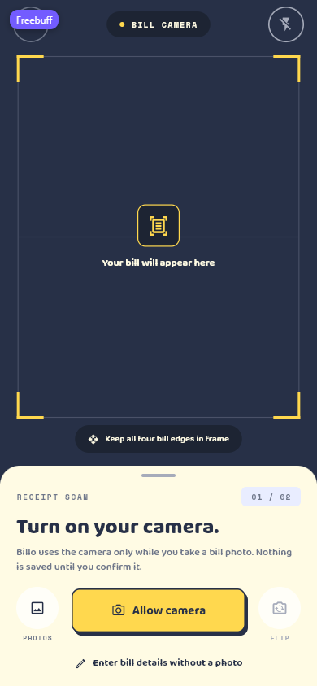

# BillScan AI

A Flutter expense app built from a paper-collage UX Pilot design: snap a bill,
check what the scanner read, and save it. Includes authentication, a spending
dashboard, a searchable bills list and a full capture → review → save flow.

| | |
|---|---|
| **Architecture** | Feature-first clean architecture (`domain` / `data` / `presentation`) with one BLoC per feature |
| **State** | `flutter_bloc` 9, sealed events/states, `equatable` |
| **Design system** | Token-driven colours, spacing, radii, shadows and typography; 13 shared widgets |
| **Responsive** | Verified at 320×568, 390×844 and 800×1000 |
| **Quality** | `flutter analyze` clean, 12 widget tests passing |

## Screens

| Dashboard | Review bill | Bill camera |
|---|---|---|
|  |  |  |

## Run

```bash
flutter pub get
flutter run -d chrome
```

```bash
flutter test
flutter analyze
```

## Documentation

- **[Complete project guide](docs/PROJECT_GUIDE.md)** — product scope, screen
  inventory, architecture, every feature and layer, design system, flows,
  responsiveness, testing, limitations and a file-by-file reference.
- **[Interview notes](docs/INTERVIEW_NOTES.md)** — 30-second/2-minute pitches,
  trade-offs, likely questions with answers, code snippets, debugging stories
  and a revision checklist.

## Structure at a glance

```
lib/
├── main.dart / app.dart        # entry point, app-level blocs, routes
├── core/                       # theme tokens, shared widgets, utils, DI, shell
└── features/
    ├── auth/                   # welcome, sign in, register
    ├── bills/                  # bill model, repository, summary, list
    ├── home/                   # spending dashboard
    ├── scan/                   # add a bill + bill camera
    └── review/                 # editable review form
```

## Notes

- The backend, camera and OCR are simulated by in-memory/simulated repositories
  with realistic latency, so the whole flow runs without keys or a device.
- Repository interfaces and a single `AppDependencies` container make those
  implementations replaceable without touching the UI.
- Fonts are fetched at runtime through `google_fonts`; widget tests disable that
  fetch for deterministic, offline runs.
