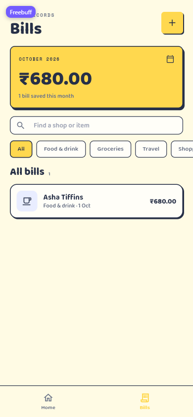
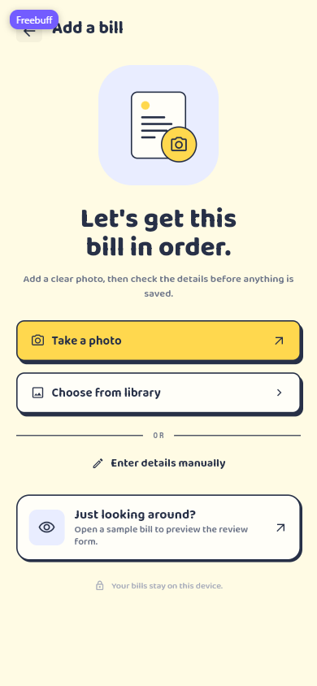
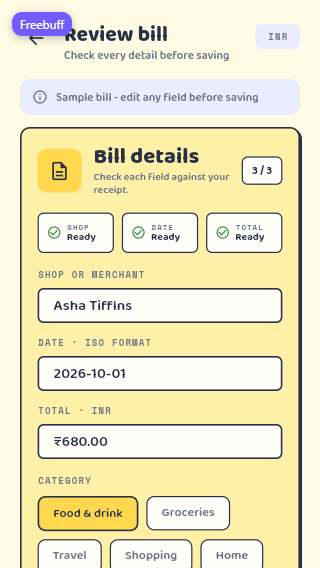
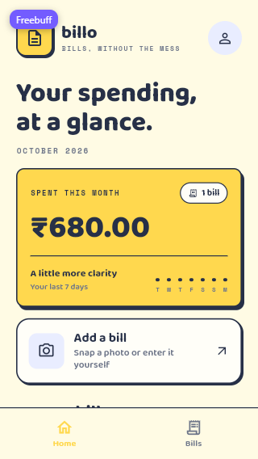

# BillScan AI — Complete Project Guide

A step-by-step guide to everything built in this repository, written so you can
explain it confidently in an interview. It covers the product scope, the
architecture, every feature and layer, the design system, the end-to-end flows,
the responsiveness strategy, the test suite, and what is deliberately not built
yet.

> Read this once end-to-end for the big picture. Then use
> [`INTERVIEW_NOTES.md`](INTERVIEW_NOTES.md) for the short pitch, likely
> questions and code snippets to memorise.

---

## 0. The project in ten lines

- **What it is:** a Flutter expense-tracking app. You sign in (or browse as a
  guest), photograph a bill, check the extracted fields, and save it.
- **Design language:** a "paper collage" style — warm cream paper, ink outlines,
  hard offset shadows, a yellow accent, lavender tint, rounded chunky type
  (Baloo 2), monospace labels (Space Mono) and a handwritten accent (Caveat).
- **Screens:** 3 auth screens + 5 post-login screens, all taken from the UX
  Pilot exports.
- **Architecture:** feature-first clean architecture
  (`domain` / `data` / `presentation`) with one BLoC per feature.
- **State:** `flutter_bloc` 9 with sealed events and sealed states, values
  compared with `equatable`.
- **DI:** a single `AppDependencies` container in `lib/core/di/injector.dart`;
  widgets only ever receive blocs, never repositories.
- **Repositories:** interfaces in `domain`; auth, bills and photo extraction
  are implemented against the FastAPI backend, all swapped through the
  container (tests use fakes and a mock HTTP client).
- **Network:** paths live only in `ApiEndpoints`; a single `ApiService` owns
  GET/POST/PUT/DELETE plus multipart uploads, JSON, bearer headers, timeouts and
  typed errors. `AuthApi` and `BillApi` are the only sources that know fields.
- **Session:** access + refresh tokens and the profile are persisted in
  SharedPreferences and restored before the app starts, so a restart reopens the
  dashboard.
- **Responsiveness:** every page scrolls, content is capped at 560 logical
  pixels, rows wrap or stack, chips scroll horizontally, and the camera sheet is
  height-capped.
- **Verification:** `flutter analyze` → no issues; `flutter test` → 69/69
  passing; live web checks at 320×568 and 390×844, plus widget tests at
  800×1000 for tablet width. Sign-in, bill listing and bill confirmation were
  also exercised against the running API.
- **Not real (yet):** provider OAuth, automatic 401 → refresh → retry, and a
  secure (rather than SharedPreferences) token vault.

---

## 1. Product scope and screen inventory

### 1.1 What the app does

A user can:

1. Enter as a guest, sign in with email/password, or register. Google/Apple
   buttons are visible but report that the backend does not offer them yet.
2. Land on a dashboard that summarises the current month, charts the last seven
   days and lists recent bills.
3. Open the full bills list, search by shop/category/item and filter by
   category.
4. Start a capture from the dashboard or the bills list.
5. Take a photo or choose one from the library, let the scanner extract a
   draft, enter details manually, or open the bundled sample bill.
6. Check and edit every field and item on the review screen, fix anything the
   scanner flagged, then confirm it to the server.
7. Return to the dashboard where the saved bill is included immediately.

### 1.2 Screens found in the design exports

The Downloads folder contained several exports. These are the unique screens
they define (files with identical sizes are duplicates):

| # | Screen | Design asset(s) | Route | Kind |
|---|--------|-----------------|-------|------|
| 1 | Welcome / landing | auth PDF (`uxpilot-export-10-04-26`), `_authpage_*.png` | `/` | Auth |
| 2 | Sign In | auth PDF | `/sign-in` | Auth |
| 3 | Register | auth PDF | `/register` | Auth |
| 4 | Home dashboard | `Bill-Expenses.png` | `/app` (tab 0) | Post-login |
| 5 | Bills list | `Bill-Expenses (1).png` | `/app` (tab 1) | Post-login |
| 6 | Add a bill | `Bill-Expenses (2).png` = `(3).png` | `/add-bill` | Post-login |
| 7 | Bill camera | `Bill-Expenses (6).png` | `/add-bill/camera` | Post-login |
| 8 | Review bill | `Bill-Expenses (4).png` = `(5).png` | `/add-bill/review` | Post-login |

**Not implemented, because no export shows them:** a bill-detail screen, a
history/analytics screen beyond the bills list, and profile/settings screens.
The dashboard's avatar is the only profile affordance in the assets, so tapping
it opens a small bottom sheet with the account identity and Sign out — not an
invented screen.

There is also an older `uxpilot-export-09-30-26.pdf` with a different,
dollar-based design (Whole Foods, Blue Bottle). It is a different concept and
was **not** used.

The review export is cropped below the second item. The visible part is
implemented exactly; the continuation (the second item's prices, a totals card
and a save action) is the minimum needed to make the flow functional and is
flagged in [Known limitations](#12-known-limitations-and-roadmap).

### 1.3 Screenshots of the running app

All screenshots are from the real web build at 390×844 (the small-phone shots
are 320×568). The small "Freebuff" badge in the top-left corner is the preview
tool's overlay, not part of the UI.

| Dashboard | Bills | Add a bill |
|---|---|---|
|  |  |  |

| Camera | Review (390) | Review (320) |
|---|---|---|
|  |  |  |

Small-phone dashboard:



---

## 2. Tech stack and dependencies

| Dependency | Version | Why it is here |
|---|---|---|
| Flutter / Dart | SDK `^3.10.4` | App framework |
| `flutter_bloc` | `^9.1.1` | Predictable, testable state management |
| `equatable` | `^3.0.0` | Value equality for entities and states |
| `google_fonts` | `^8.2.1` | Baloo 2, Space Mono and Caveat without shipping font binaries |
| `http` | `^1.6.0` | The one HTTP client used by `ApiService` |
| `http_parser` | `^4.1.2` | The `MediaType` for a multipart photo part |
| `shared_preferences` | `^2.5.5` | Persists the token pair and profile across launches |
| `image_picker` | `^1.2.3` | Library picker for the bill photo (and the no-camera fallback) |
| `camera` | `^0.12.0+2` | In-app preview, shutter, torch and lens switch for the bill camera |
| `flutter_lints` | `^6.0.0` | The lint set used by `flutter analyze` |
| `flutter_test` | SDK | Widget and unit tests |

**Why no code generation (freezed/json_serializable)?** The state shapes are
small and handwritten `copyWith`/`props` are easy to read. `equatable` gives the
equality BLoC needs without a build step. The API surface is two small mapper
files (`AuthTokens`/`ApiUser` and `BillMapper`), so handwritten JSON is smaller
than adding `build_runner`. Revisit if the API grows many more shapes.

**Why `http` instead of Dio?** The needs are four verbs, JSON, one bearer
header and typed errors; `http` does that with a smaller surface, and
`MockClient` (from the same package) makes every network branch testable without
a server. Dio's interceptors become attractive when uploads, retries and logging
stack up.

**Why no `get_it`?** There is one dependency container (`AppDependencies`) with
three repositories and four bloc factories. A package would add indirection for
no benefit at this size. Swapping in `get_it` later only touches
`injector.dart` and `main.dart`.

---

## 3. Running and verifying

```bash
# terminal 1 — the Bill Reader API (its own README)
uv run main.py                # http://127.0.0.1:8000

# terminal 2 — the app
flutter pub get
flutter run -d chrome --dart-define=API_BASE_URL=http://127.0.0.1:8000
flutter test
flutter analyze
```

Current verified state:

- `flutter analyze` → **No issues found!** (exit code 0)
- `flutter test` → **69/69 tests passed** (exit code 0)
- A real sign-in against the running API was exercised in the browser: login,
  `GET /auth/me`, dashboard, profile name and sign-out all completed.
- The bill contract was exercised against the running API with the same payloads
  the app sends: `GET /bills` (empty), `POST /bills/confirm` (201), `GET /bills`
  (the saved row), and a wrong total (422 with `detail.problems`).

Notes:

- `API_BASE_URL` defaults to `http://127.0.0.1:8000`; the define only matters
  for another host. The Android emulator reaches the machine at `10.0.2.2`.
- The browser enforces CORS. The FastAPI app must send
  `Access-Control-Allow-Origin` for the Flutter origin; the data layer is
  otherwise unchanged. Native targets do not have this constraint.
- The web build uses `google_fonts` at runtime, so the first load needs network
  access for the fonts. Tests disable runtime fetching.
- Guest mode never calls the API. Email auth, bills and extraction do.
- iOS declares `NSCameraUsageDescription` and `NSPhotoLibraryUsageDescription`
  for the picker; Android needs no extra permission for the picker intents.
- The token pair and profile are in SharedPreferences, so a restart reopens the
  dashboard. This is persistence, not a secure vault: swap
  `SharedPreferencesSessionStorage` for `flutter_secure_storage` without
  touching the feature above it.

---

## 4. Folder structure

```
lib/
├── main.dart                     # builds AppDependencies, starts BillScannerApp
├── app.dart                      # app root: providers, auth listener, routes
│
├── core/                         # cross-feature code
│   ├── di/
│   │   └── injector.dart         # AppDependencies: the single composition root
│   ├── navigation/
│   │   ├── app_routes.dart       # route names shared across features
│   │   └── app_shell.dart        # signed-in shell + bottom navigation
│   ├── network/
│   │   ├── api_config.dart       # base URL + --dart-define
│   │   ├── api_endpoints.dart    # every backend path in one list
│   │   ├── api_exception.dart    # sealed, user-safe failures
│   │   └── api_service.dart      # four verbs + multipart, JSON, auth, errors
│   ├── theme/
│   │   ├── app_colors.dart       # palette sampled from the exports
│   │   ├── app_dimensions.dart   # spacing, radii, strokes, shadows, layout
│   │   ├── app_text_styles.dart  # display / label / hand typography
│   │   └── app_theme.dart        # ThemeData assembled from the tokens
│   ├── utils/
│   │   ├── currency.dart         # ₹ formatting and tolerant parsing
│   │   ├── date_formats.dart     # OCTOBER 2026, "1 Oct", ISO parse/format
│   │   └── form_validators.dart  # email / required / password validators
│   └── widgets/                  # 13 reusable paper components
│       ├── action_tile.dart
│       ├── brand_mark.dart
│       ├── page_scaffold.dart
│       ├── paper_button.dart
│       ├── paper_card.dart
│       ├── paper_checkbox.dart
│       ├── paper_chip.dart
│       ├── paper_icon_button.dart
│       ├── paper_text_field.dart
│       ├── screen_header.dart
│       ├── section_heading.dart
│       ├── section_label.dart
│       └── text_link.dart
│
└── features/
    ├── auth/
    │   ├── domain/
    │   │   ├── entities/         # AppUser, AuthProvider
    │   │   ├── failures/         # AuthFailure
    │   │   ├── repositories/     # AuthRepository (contract)
    │   │   └── usecases/         # SignIn, Register, ProviderSignIn, Guest, SignOut
    │   ├── data/
    │   │   ├── datasources/      # AuthApi (the five endpoints)
    │   │   ├── models/           # AuthTokens, ApiUser
    │   │   ├── session/          # AuthTokenStore + SharedPreferences storage
    │   │   └── repositories/     # ApiAuthRepository, InMemoryAuthRepository
    │   └── presentation/
    │       ├── bloc/             # AuthBloc + sealed events/states
    │       ├── pages/            # Welcome, SignIn, Register
    │       └── widgets/          # AuthPageScaffold, AuthFooterPrompt
    ├── bills/
    │   ├── domain/
    │   │   ├── entities/         # Bill, BillItem, BillCategory, BillSummary,
    │   │   │                     # BillExtraction, BillProblem
    │   │   ├── failures/         # BillFailure (may carry server problems)
    │   │   ├── repositories/     # BillRepository (list + confirm + extract)
    │   │   └── usecases/         # FetchBills, SaveBill, ExtractBill
    │   ├── data/
    │   │   ├── datasources/      # BillApi (three endpoints)
    │   │   ├── models/           # BillMapper (JSON ⇄ domain)
    │   │   ├── sample_bill.dart  # the demo bill used by seed + previews
    │   │   └── repositories/     # ApiBillRepository, InMemoryBillRepository
    │   └── presentation/
    │       ├── bloc/             # BillsBloc + events/states
    │       ├── pages/            # BillsPage
    │       └── widgets/          # BillTile
    ├── home/
    │   └── presentation/
    │       └── pages/            # HomePage (reads BillsBloc)
    ├── scan/
    │   ├── domain/
    │   │   ├── entities/         # ScanSource (camera / gallery)
    │   │   ├── repositories/     # ScanRepository
    │   │   └── usecases/         # CaptureBill
    │   ├── data/
    │   │   └── repositories/     # ApiScanRepository, SimulatedScanRepository
    │   └── presentation/
    │       ├── bloc/             # ScanBloc + events/states
    │       ├── pages/            # AddBillPage, ScanPage
    │       └── widgets/          # CaptureFrame, ScannerIllustration
    └── review/
        └── presentation/
            ├── bloc/             # ReviewBloc + events/states
            └── pages/            # ReviewPage
```

**Reading the tree:** `core` holds things that two or more features need.
Everything feature-specific stays inside its feature, and each feature is split
into the three clean-architecture layers. The dependency direction is always
inwards:

```
presentation ──> domain <── data ──> core/network
      │             ▲
      └── core ─────┘
```

- `domain` knows nothing about Flutter, blocs, HTTP or storage.
- `data` implements the domain's repository interfaces; only this layer imports
  `core/network`.
- `presentation` depends on domain (entities + use cases) and core widgets.
- `core` has no knowledge of any feature. `ApiService` knows verbs and JSON,
  not users or bills.

A useful interview sentence: *"The domain layer is the contract; data is one
possible implementation; presentation is one possible viewer. Swapping any
outer layer does not change the centre."*

### 4.1 Suggested code-reading order

Read the project in this order; each step only depends on earlier ones.

| Step | Read | Look for |
|---|---|---|
| 1 | `lib/main.dart` | The only entry side effect: build dependencies, run the app |
| 2 | `lib/core/di/injector.dart` | How blocs are built and how repositories can be replaced |
| 3 | `lib/core/network/*` | `ApiConfig` → exception types → the four verbs in `ApiService` |
| 4 | `lib/core/theme/*` | Tokens first: colours → dimensions → type → theme |
| 5 | `lib/core/widgets/page_scaffold.dart` | The responsive frame every page reuses |
| 6 | `lib/features/auth/domain/**` | Entity → failure → repository contract → five use cases |
| 7 | `lib/features/auth/data/**` | `AuthApi` → `ApiAuthRepository`; token storage and error translation |
| 8 | `lib/features/auth/presentation/bloc/**` | Event/state design and the shared `_run` helper |
| 9 | `lib/app.dart` | Route table, `onGenerateRoute`, auth listener, bloc ownership |
| 10 | `lib/core/navigation/app_shell.dart` + `home` + `bills` | Tabs, shared `BillsBloc`, dashboard/list composition |
| 11 | `lib/features/scan/**` | Add-bill entry points, camera painting, scan state machine |
| 12 | `lib/features/review/**` | The richest state: raw text, derived validation, save flow |
| 13 | `test/` | Widget paths plus the `MockClient` network/auth tests |

A good exercise: after reading step 8, close the file and draw the auth
state diagram from memory. After step 12, do the same for the review state and
name the three places validation is enforced (form, state getters, submit).

### 4.2 Why `home` and `review` have no data/domain folders

`home` is a pure composition screen: it reads the `BillsBloc`, which owns the
bills data. Adding an empty `data/` folder would be ceremony, not architecture.
`review` is a form over the bills domain: it uses `Bill`, `BillCategory`,
`BillItem` and the `SaveBill` use case, so it has no repository of its own. Its
editing state (raw text, validation) genuinely belongs to presentation.

---

## 5. Architecture in detail

### 5.1 The layers

| Layer | Contains | Must not contain | Example |
|---|---|---|---|
| Domain | entities, repository interfaces, use cases, failures | Flutter imports, HTTP, storage | `Bill`, `BillRepository`, `SaveBill` |
| Data | repository implementations, API clients/models, sample data | widgets, blocs | `ApiAuthRepository`, `InMemoryBillRepository` |
| Presentation | blocs, pages, feature widgets | direct repository access | `BillsBloc`, `BillsPage` |

### 5.2 Anatomy of a feature (the pattern every feature follows)

```
User tap
   │
   ▼
Page (StatelessWidget / StatefulWidget for controllers)
   │  context.read<FeatureBloc>().add(FeatureEvent(...))
   ▼
Bloc.on<Event>  ── calls a use case ──>  UseCase
   │                                      │
   │                                      ▼
   │                              Repository interface (domain)
   │                                      │
   │                                      ▼
   │                              Implementation (data)
   ▼
emit(NewState)  ──>  BlocBuilder rebuilds the page
```

Concrete example (saving a bill):

1. `ReviewPage` sends `ReviewSubmitted`.
2. `ReviewBloc` validates `ReviewEditing`, emits `isSaving: true`, then calls
   `_saveBill(editing.toBill())`.
3. `SaveBill` calls `BillRepository.save`.
4. `InMemoryBillRepository` assigns an id, stores the bill, returns it.
5. `ReviewBloc` emits `ReviewSaved(saved)`.
6. `ReviewPage`'s `BlocConsumer` listener triggers `BillsReloaded`, shows the
   "Bill saved" snack bar, and pops back to the shell.
7. `BillsBloc` refetches, emits `BillsLoaded`; the dashboard and list rebuild
   automatically.

### 5.3 BLoC conventions used everywhere

1. **Sealed events and states.** `sealed class` plus exhaustive `switch` means
   the compiler tells you when a new state is unhandled.
2. **Immutable state.** Every state is `const`-constructible where possible and
   exposes only `final` fields.
3. **Value equality via `Equatable`.** BLoC skips emitting an equal state, and
   `BlocConsumer` can compare previous/current states in `listenWhen`.
4. **Loading before the await.** `emit(Loading())` happens *before* the async
   call, otherwise the spinner can be missed.
5. **Errors are states, not thrown into the UI.** Repositories throw typed
   failures; blocs catch them and emit a user-facing state/message.
6. **Parsing lives in the state.** The review form keeps strings and exposes
   getters (`date`, `total`, `isValid`) instead of mutating on every keystroke.
7. **One event = one intention.** `BillsSearchChanged` carries the query;
   `ReviewItemAmountChanged` carries the item index and the printed line amount.
8. **Blocs are the only stateful layer.** Pages own only controllers and local
   UI toggles (e.g. the terms checkbox).

### 5.4 Dependency injection

`lib/core/di/injector.dart`:

```dart
final class AppDependencies {
  /// Production: open SharedPreferences, restore the session, use the API.
  static Future<AppDependencies> create() async {
    final prefs = await SharedPreferences.getInstance();
    final tokens = AuthTokenStore(
      storage: SharedPreferencesSessionStorage(prefs),
    );
    await tokens.restore();

    final api = _apiFor(tokens);
    final auth = ApiAuthRepository(authApi: AuthApi(api), tokens: tokens);
    final user = await auth.restoreSession();
    final bills = ApiBillRepository(billApi: BillApi(api));

    return AppDependencies._(
      authRepository: auth,
      billRepository: bills,
      scanRepository: ApiScanRepository(billRepository: bills),
      restoredUser: user,
    );
  }

  /// Tests/previews: injectable repositories default to the in-memory pair.
  factory AppDependencies({
    AuthRepository? authRepository,
    BillRepository? billRepository,
    ScanRepository? scanRepository,
    AppUser? restoredUser,
  }) { ... }

  AuthBloc createAuthBloc() { ... }        // passes restoredUser
  BillsBloc createBillsBloc() { ... }
  ScanBloc createScanBloc() { ... }
  ReviewBloc createReviewBloc({required Bill bill, List<BillProblem> problems}) { ... }
}
```

Why this shape:

- **One composition root.** `main.dart` awaits `AppDependencies.create()`,
  which opens SharedPreferences, restores the session and wires the live API.
  Tests use the synchronous factory and inject an in-memory auth repository (or
  an `ApiAuthRepository` with a `MockClient`) plus zero-latency bill/scan fakes.
- **Shared repository instances.** The bills repository is created once and
  injected into `FetchBills`, `SaveBill` and `ExtractBill`, so a save is
  immediately visible to the list and the scanner uses the same base URL/token.
- **Blocs are created where they are owned.** Auth and Bills live for the whole
  app (`BillScannerApp` creates and disposes them); Scan and Review are scoped to
  their route (`BlocProvider(create: ...)` in `onGenerateRoute`).
- **No widget imports a repository.** Pages can only `context.read<XBloc>()`.

If you were asked "how would you swap this for `get_it`?", the answer is: keep
`AppDependencies` and register its factories in `get_it`; nothing else changes.
If asked "how do you test?", inject fakes through the same constructor.

### 5.5 Navigation

Routes are named constants on the page classes (`WelcomePage.routeName`, ...),
with `AppRoutes.shell` shared because both the review flow and the auth listener
need it.

| Route | Built how | Why |
|---|---|---|
| `/` | `routes` map | initial route, stays as the stack root |
| `/sign-in`, `/register` | `routes` map | simple screens, no arguments |
| `/app` | `routes` map | shell with Home/Bills tabs |
| `/add-bill` | `onGenerateRoute` | needs the demo bill from DI |
| `/add-bill/camera` | `onGenerateRoute` | takes a `ScanSource` argument (camera/gallery) + route-scoped `ScanBloc` |
| `/add-bill/review` | `onGenerateRoute` | takes a `BillExtraction` (or a `Bill` for manual entry) + route-scoped `ReviewBloc` |

Key navigation decisions:

- **After authentication** the app calls
  `pushNamedAndRemoveUntil(AppShell.routeName, ModalRoute.withName(WelcomePage.routeName))`.
  This removes the Sign In/Register screens but keeps Welcome as the root, so
  signing out can pop back to it. (Earlier, removing *all* routes stranded the
  user on Home after sign-out; this is a good debugging story.)
- **On launch with a saved session**, `MaterialApp.initialRoute` is the shell, and
  `AuthBloc` starts in `AuthAuthenticated(restoredUser)`, so no welcome flash.
  Sign-out emits `AuthInitial`; the listener clears the stack and shows Welcome.
- **After saving a bill** the review flow calls
  `popUntil(ModalRoute.withName(AppRoutes.shell))`, which removes review,
  camera and add-bill in one go and returns to the correct tab.
- **Tab switching** is local `setState` in `AppShell` over an `IndexedStack`.
  Home's "See all" calls a callback supplied by the shell, so navigation stays
  in the shell rather than pushing a duplicate Bills page.

### 5.6 State ownership

| Bloc | Created in | Lifetime | Shared by |
|---|---|---|---|
| `AuthBloc` | `BillScannerApp` | whole app, closed in `dispose` | Welcome, SignIn, Register, auth listener, profile sheet |
| `BillsBloc` | `BillScannerApp` | whole app | Home, Bills, review (reload after save) |
| `ScanBloc` | camera route builder | camera route | ScanPage |
| `ReviewBloc` | review route builder | review route | ReviewPage |

This is the "lift state only as far as needed" rule: the bills list and
dashboard must agree, so their state lives above both; the scan session is
meaningless after leaving the camera, so it dies with the route.

### 5.7 Error handling and validation

There are three different mechanisms on purpose:

1. **Form validation** (auth) — `Form` + `TextFormField.validator` +
   `FormValidators`, so errors appear inline while typing/submitting.
2. **Domain failures** — `AuthFailure` (message safe for users) and generic
   `Exception`s from repositories; blocs convert them into `AuthError`,
   `BillsFailure`, `ScanFailure`, or `failureMessage` on the review state.
3. **Presentation guards** — `ReviewEditing.isValid` blocks submission and
   flips `submitted: true` so every field can show its error at once.

Only one place shows auth errors: `BillScannerApp`'s `BlocListener` uses the
app-level `ScaffoldMessenger` key. Auth pages therefore do not need their own
error UI. Review failures are shown by the review page's listener because they
belong to that screen.

### 5.8 The network layer and the auth API

```
AuthPage → AuthBloc → SignInWithEmail → AuthRepository (domain)
                                             │
                                    ApiAuthRepository (data)
                                       │             │
                                 AuthTokenStore   AuthApi
                                                    │
                                                ApiService ──> FastAPI
```

**`ApiEndpoints`** (`lib/core/network/api_endpoints.dart`) is the only place a
URL lives. `AuthApi` and `BillApi` build from it, so a route rename is one edit
and no screen or repository knows a path.

**`ApiService`** (`lib/core/network/api_service.dart`) is the only class that
touches `package:http`. It exposes the verbs the backend needs plus an upload:

| Method | Body | Used today |
|---|---|---|
| `get` | query parameters | `GET /auth/me`, `GET /bills` |
| `post` | JSON | auth, `POST /bills/confirm` |
| `postMultipart` | file part + bearer | `POST /bills/extract` |
| `put` | JSON | available; no endpoint needs it yet |
| `delete` | optional body | available; no endpoint needs it yet |

What it centralises:

- the absolute URI from `ApiConfig.baseUrl` + path + query;
- `Accept: application/json`, `Content-Type` for a body, and
  `Authorization: Bearer <access token>` when `authenticated: true`;
- a 30-second timeout, including the multipart send;
- JSON decoding, including an empty `204`;
- non-2xx responses → typed exceptions: `NetworkApiException`,
  `TimeoutApiException`, `Unauthorized` (401), `Forbidden` (403), `NotFound`
  (404), `Conflict` (409), `BadRequest` (400), `PayloadTooLarge` (413),
  `UnsupportedMediaType` (415), `Validation` (422 with a `field → message`
  map and the full `problems` list), `RateLimited` (429 + `Retry-After`),
  `Server` (5xx) and `ApiFormatException`.

The 422 parser understands both FastAPI shapes: the standard `detail[]` list
and the bill route's `detail: {message, problems: [{field, message}]}`.

**`AuthApi`** knows the five auth endpoints and their JSON field names:
`POST /auth/register`, `POST /auth/login`, `POST /auth/refresh`,
`POST /auth/logout`, `GET /auth/me`.

**`ApiAuthRepository`** turns API vocabulary into domain vocabulary:

| Situation | Result |
|---|---|
| login succeeds | save the pair, call `/auth/me`, return and store `AppUser` |
| login 401 | clear tokens, `AuthFailure('Email or password is incorrect.')` |
| register 409 (or 400 saying "already") | `AuthFailure('That email is already registered…')` |
| 422 | use the server's field message (for example password length) |
| timeout / `ClientException` | "Could not reach the server…" |
| refresh 401 | clear tokens; the next authenticated call fails cleanly |

**Token lifecycle.** `AuthTokenStore` keeps the pair and the profile in memory
for synchronous reads by `ApiService`, and writes every change through
`SessionStorage`. Production uses `SharedPreferencesSessionStorage`; tests use
`InMemorySessionStorage`, so no plugin is needed. `main()` awaits
`AppDependencies.create()`, which restores the store before `runApp`, and the
app starts on the shell when a user was restored. `refreshSession()` rotates the
pair (the backend makes the old refresh token single-use). Sign-out clears
memory and storage first, then revokes the refresh token best-effort, so a dead
server cannot trap the user in the app.

**Why the display name is derived.** `GET /auth/me` returns `{id, email}` only.
Registration keeps the typed name; later sign-ins turn `asha.tiffins@…` into
"Asha Tiffins". Provider buttons have no endpoint yet and fail with a sentence
saying so.

**The bill API.** `BillApi` owns the three routes and `BillMapper` owns the
JSON translation:

| Call | Request | Response | Client result |
|---|---|---|---|
| List | `GET /bills` | `ExpenseOut[]` | `List<Bill>` (newest first) |
| Extract | `POST /bills/extract` (multipart `file`) | `{draft, problems}` | `BillExtraction(bill, problems)` |
| Confirm | `POST /bills/confirm` `{draft}` | `ExpenseOut` (201) | the saved `Bill` |

Contract details the mapper enforces:

- **Money is rupees, as a string.** `"128.00"` becomes a `double` for UI; confirm
  sends `toStringAsFixed(2)`. The app never sends paise.
- **`items[].amount` is the whole line.** `BillItem` no longer multiplies a price
  by a quantity; `qty` is optional information. This matches the backend's
  MRP/rate/discount/GST rule.
- **Ten fixed categories.** `BillCategory` carries `label`, API `slug` and a
  default HugeIcons name; an unknown slug falls back to `other` instead of
  crashing. Confirm sends the slug and `icon`, so the saved row stays drawable.
- **Problems are data.** A 422 from confirm becomes `BillFailure` with
  `List<BillProblem>`; `ReviewBloc` keeps them and the review page lists them in
  a warning card instead of a generic "could not save".
- **Failure translation.** 413 → photo too large, 415 → JPG/PNG only, 429 → quota
  spent, 5xx → scanner busy, offline/timeout → connection message.

`InMemoryBillRepository` implements the same three methods for widget tests and
previews, seeding the design's sample bill.

**CORS.** Browsers refuse cross-origin calls unless the API answers the
preflight. Native builds are unaffected. The backend still needs
`CORSMiddleware` (or a local proxy) for `flutter run -d chrome`; that is a
deployment fact, not an app-layer bug.

---

## 6. Design system

### 6.1 Tokens

Sampled from the PNG exports and centralised in `lib/core/theme`.

**Colours** (`AppColors`):

| Token | Value | Used for |
|---|---|---|
| `paper` | `#FFFBE4` | page background, dark-screen bottom sheet |
| `surface` | `#FFFEF8` | cards, inputs, secondary buttons |
| `ink` | `#273047` | text, borders, shadows, camera background |
| `inkMuted` | `#6E7689` | secondary text, mono labels |
| `inkFaint` | `#A6ABBA` | hints, disabled controls, footers |
| `accent` | `#FFD84E` | primary buttons, active tabs, highlight tile |
| `accentSoft` | `#FFF0A8` | review "Bill details" card |
| `lavender` | `#E9EDFF` | icon tiles, pills, sample banner |
| `inkDeep` | `#1D2433` | camera pills and controls |
| `nightLine` | `#4A5168` | camera frame outlines |
| `success` | `#3E8E4E` | "Ready" checks |
| `danger` | `#B3261E` | validation errors |

**Spacing** (`AppSpacing`): 4, 8, 12, 16, 24, 32 (`xs` → `xxl`).

**Radii** (`AppRadius`): 6 chips/fields, 10 tiles/buttons, 16 cards, 24 sheet,
999 pills.

**Strokes** (`AppStroke`): 1.2 hairlines, 1.6 standard ink borders, 2 brand tile.

**Shadows** (`AppShadows`): hard, zero-blur offsets — `small` (2,2) for rows,
`medium` (3,4) for primary surfaces.

**Layout** (`AppLayout`): `maxContentWidth = 560`, `wideBreakpoint = 720`,
`gutter = 20`, `wideGutter = 32`, `navHeight = 64`.

**Typography** (`AppFonts`): `display()` (Baloo 2), `label()` (Space Mono,
letter-spaced uppercase) and `hand()` (Caveat). Each takes only the values that
vary (size, weight, colour, height, letter-spacing), so no page hardcodes a font.

### 6.2 Shared widgets (`lib/core/widgets`)

Promotion rule used in this pass: a new widget goes into `core/widgets` only if
at least two screens need the same markup/behaviour.

| Widget | What it adds | Used by |
|---|---|---|
| `PageScaffold` | scrollable, centered, width-capped page frame with responsive gutters | Home, Bills, Add bill, Review |
| `ScreenHeader` | back arrow + title + caption + trailing control | Add bill, Review |
| `SectionHeading` | section title + caption + trailing action | Home, Bills, Review |
| `ActionTile` | lavender icon, title, caption, arrow | Home "Add a bill", Add-bill "Just looking around?" |
| `PaperChip` | selectable outlined chip | Bills filters, Review categories |
| `PaperButton` | primary/secondary/ghost, loading, press-into-shadow, optional leading/trailing icon and start alignment | every screen |
| `PaperCard` | inked card with hard shadow | summary cards, review panels, item cards |
| `PaperTextField` | labelled paper input; optional initial value, prefix, error, mono label, label-less | auth forms, review |
| `PaperIconButton` | square/circular icon button, optional border/shadow/dark variant | headers, avatar, camera controls |
| `PaperCheckbox` | square checkbox with a label slot | Register terms |
| `SectionLabel` | uppercase mono eyebrow | most screens |
| `TextLink` | accent-underlined text action | auth footers |
| `BrandMark` | yellow app tile + optional wordmark/tagline | Welcome |

Feature-only widgets stay in the feature: `BillTile` (bills), `CaptureFrame` and
`ScannerIllustration` (scan), `AuthPageScaffold` and `AuthFooterPrompt` (auth).

### 6.3 Component details worth mentioning

- **`PaperButton`** animates into its own shadow on press (translate 3,4 and drop
  the shadow), disables itself while loading, and uses a `Flexible`/`Expanded`
  label so long labels ellipsize instead of overflowing.
- **`PaperTextField`** builds one `OutlineInputBorder` and reuses it for
  enabled/focused/error states, so every field has identical geometry. The label
  is optional for fields that sit under their own heading (review item name).
- **`PaperIconButton`** has `circle`, `borderColor: null`, `iconColor` and
  `elevated` variants, which is how the same widget serves the dashboard avatar,
  the camera close/flash buttons and the photos/flip circles.
- **`PageScaffold`** is the responsiveness backbone: `SafeArea` →
  `LayoutBuilder` → `SingleChildScrollView` → `Center` → `ConstrainedBox(maxWidth: 560)`
  → stretch `Column`. Every page gets scroll safety, gutters that grow on
  tablets, and a readable measure without any per-page math.

---

## 7. Feature deep dives

### 7.1 Authentication

**Files:** `lib/features/auth/**`

**Domain**

- `AppUser` — id, name, email, `isGuest`.
- `AuthProvider` — `google`, `apple`.
- `AuthFailure` — an exception carrying a message safe to display.
- `AuthRepository` — `signIn`, `register`, `signInWithProvider`,
  `continueAsGuest`, `restoreSession`, `signOut`.
- Five single-purpose use cases wrap the write methods. They look thin, but they
  are the seam where rules (rate limiting, analytics) live, and they keep the
  bloc independent of the repository API.

**Data**

`ApiAuthRepository` is the default. It composes `AuthApi` (five endpoints) with
`AuthTokenStore`, and translates every `ApiException` into an `AuthFailure`:

- login → store the token pair → `GET /auth/me` → `AppUser`;
- register → `POST /auth/register` → login → `me`, keeping the typed name;
- duplicate email, wrong password, 422 field errors, timeouts and offline all
  become readable messages;
- sign-out clears the tokens and profile, then revokes the refresh token
  best-effort;
- `refreshSession()` rotates the pair for a future 401 retry;
- `restoreSession()` returns the cached profile (or calls `me` when only a token
  pair was stored); guest mode is local and saved as a profile without tokens;
- provider buttons report that the backend does not offer them yet.

`InMemoryAuthRepository` remains for tests and offline demos: 700 ms simulated
latency, password rule, duplicate tracking, derived name and simulated social
providers. Widget tests inject it with `Duration.zero`; the API-path widget test
injects `ApiAuthRepository` with a `MockClient`.

**Presentation**

`AuthBloc` reduces every request to one helper:

```dart
Future<void> _run(
  Emitter<AuthState> emit,
  Future<AppUser> Function() request,
) async {
  emit(const AuthLoading());
  try {
    emit(AuthAuthenticated(await request()));
  } on AuthFailure catch (failure) {
    emit(AuthError(failure.message));
  }
}
```

States: `AuthInitial`, `AuthLoading`, `AuthAuthenticated(user)`,
`AuthError(message)`. The constructor accepts `restoredUser`, so a saved session
starts already authenticated instead of flashing the welcome page.

Sign-out emits `AuthInitial` first, then waits for `SignOut` to finish. The
state change is immediate so the UI returns to Welcome without waiting on the
network; token clearing and the `POST /auth/logout` revocation happen behind
it. A failed revocation is swallowed because the local session is already gone.

**Pages**

- `WelcomePage` — brand, quote card, Sign In/Join/Continue as guest. Its body
  scrolls on short phones and stays vertically centred on tall ones.
- `SignInPage` / `RegisterPage` — `Form` with controllers disposed in
  `dispose`, inline validation, loading buttons, social buttons, footer links.
  Register also has the terms checkbox and its own agreement error.

`app.dart` listens to `AuthBloc`: authenticated → shell; initial (sign-out) →
welcome with a cleared stack; error → snack bar. This is the only navigation
decision triggered by auth state.

### 7.2 Bills (dashboard data + list)

**Files:** `lib/features/bills/**`

**Entities**

```dart
class Bill {
  final String id;          // empty until saved
  final String merchant;
  final DateTime date;
  final double total;
  final BillCategory category;
  final List<BillItem> items;
  final String currency;    // INR today
  final double? roundOff;   // printed Round Off, when present
  final String? icon;       // HugeIcons name from the API
  final String? notes;
  final bool isSample;      // drives the review banner
}
```

`BillItem` stores `name`, the printed `amount` for the whole line and an optional
`quantity`; `lineTotal` is the amount, never quantity × price. `Bill.itemsTotal`
sums those lines.

`BillCategory` has ten values matching the backend slugs; each carries a display
`label`, an API `slug` and a default HugeIcons `icon`. `fromSlug` falls back to
`other` for a value this build does not know.

**Derived data: `BillSummary`**

`BillSummary.fromBills(bills, today)` computes:

- `spentThisMonth` and `billCountThisMonth` for bills in the current calendar
  month;
- `lastSevenDays`: seven `DaySpend` values ending today, each with a weekday
  initial and the sum of that day's bills;
- `peakDaySpend`, used to scale the bars.

Keeping this as a pure factory (no Flutter, no bloc) makes it easy to unit test
and keeps the dashboard dumb.

**Repository**

`BillRepository` has three operations: `fetchBills`, `save` (confirm) and
`extract`. Production uses `ApiBillRepository`, which composes `BillApi` and
`BillMapper`:

- `fetchBills()` → `GET /bills`, mapped to domain bills;
- `save(bill)` → `POST /bills/confirm` with the edited draft; the returned row
  is the saved bill and its real id;
- `extract(...)` → `POST /bills/extract` with the photo; returns the draft plus
  `BillProblem`s without writing anything;
- a refused confirm (422) throws `BillFailure` carrying every problem, so the
  form can show the server's reason.

`InMemoryBillRepository` mirrors all three for tests and previews: it seeds the
sample bill (Asha Tiffins, two 340 lines, 680), returns a sample extraction, and
assigns `bill-N` ids on save. The dashboard/list widget tests therefore run with
no network.

**Session routing.** `SessionBillRepository` and `SessionScanRepository` are
decorators over the API and local implementations. They read
`AuthTokenStore.hasSession` at call time: a signed-in user goes to the API, a
guest stays in the local demo. This is why guest mode does not fail with
"session expired" on the dashboard, and no bloc or page branches on auth.

**Use cases:** `FetchBills`, `SaveBill`, `ExtractBill`.

**BLoC**

`BillsBloc` owns the full list plus the current query and category:

```dart
List<Bill> _bills = const [];
String _query = '';
BillCategory? _category;
```

States:

- `BillsLoading`
- `BillsLoaded(bills, visibleBills, query, category)` with `hasActiveFilter` and
  `recent()`
- `BillsFailure(message)`

Events:

- `BillsStarted` (shell init) → loading + fetch
- `BillsReloaded` (after a save) → fetch without a loading flash
- `BillsSearchChanged` / `BillsCategoryChanged` → recompute filtered list
- `BillsRetryRequested` → loading + fetch

Search matches the merchant, the category label and any item name,
case-insensitively. The full list and the filtered list are both stored so the
dashboard's month summary is unaffected by a filter on the list screen.

**Why one BillsBloc for two screens?** The dashboard and the list must never
disagree about the saved bills. Sharing the bloc removes any sync logic. The
cost is that the bloc holds two lists; the alternative (two blocs + a stream)
is more moving parts for the same result at this scale.

**Bills page**

- header with count and `+` button;
- yellow month card;
- search field (stateful controller, reports every change);
- horizontally scrollable category chips (`All` + enum values);
- "All bills" count and bill rows via the shared `BillTile`;
- empty states distinguish "no bills" from "no matches".

### 7.3 Home dashboard

**Files:** `lib/features/home/presentation/pages/home_page.dart` (and the
profile sheet inside it)

The page is a `BlocBuilder<BillsBloc, BillsState>` inside `PageScaffold`:

- brand row (`billo` + tagline) and lavender avatar;
- headline and month eyebrow from `DateFormats.monthYear(DateTime.now())`;
- `_SpendingCard` built from `BillSummary.fromBills(...)`:
  "Spent this month", bill-count pill, big rupee total, divider, "A little more
  clarity" + seven-day strip;
- `ActionTile` for "Add a bill";
- `SectionHeading` with a "See all" action that switches tab;
- recent bills (first three) using `BillTile`.

The seven-day bars are data-driven: each bar's height is
`4 + (day.amount / peak) * 22`, so an empty week renders as a flat row of dots
instead of a fake tall bar. The export's tall bar corresponds to its sample bill
date; the demo bill is dated the first of the month, which is not necessarily in
the current seven-day window.

Loading and failure states are handled on the same page; failure offers a retry
that re-emits `BillsStarted`.

**Profile sheet:** tapping the avatar reads the current `AuthBloc` user and opens
a bottom sheet with name, email/guest label and Sign out. Sign out dispatches
`AuthSignOutRequested` and `popUntil(isFirst)` to return to Welcome.

### 7.4 Scan (Add a bill + camera)

**Files:** `lib/features/scan/**`

**Domain**

- `ScanSource` — `camera` or `gallery`.
- `CapturedPhoto` — the bytes the shutter produced (`bytes`, `filename`,
  `contentType`), so the camera itself never reaches the network.
- `ScanRepository`: `capture(ScanSource)` for the picker path,
  `read(CapturedPhoto)` for a photo that is already in hand, and
  `Bill get sampleBill`. `null` means the picker was cancelled.
- `CaptureBill` (pick + read in one call) and `ReadPhoto` (read only).

**Camera (presentation)**

The device camera sits behind `CameraDriver` (`presentation/camera/`), so no
widget and no bloc imports the plugin:

| Implementation | Used by | Behaviour |
|---|---|---|
| `PluginCameraDriver` | production | `camera` plugin: `open()` requests permission and starts the preview, `takePicture()` returns a `CapturedPhoto`, plus torch and lens switching; `CameraException` codes map to the status |
| `SimulatedCameraDriver` | tests and previews | reports a configurable status (including `denied`), draws a stand-in preview, counts opens and captures |

`CameraStatus` is `idle → starting → live`, or `denied` / `unavailable`.
Android declares `CAMERA` in the manifest and iOS carries
`NSCameraUsageDescription`, but the runtime request happens in `open()`, i.e.
when the screen opens or the retry button is pressed.

**Data**

`ApiScanRepository` either picks an image with `image_picker` (`imageQuality:
90`, resized to 2400 px) or accepts a `CapturedPhoto` from the shutter, and both
paths call `BillRepository.extract`. It keeps no copy of the photo after the
request. The picker is injectable, so tests use an `XFile` and never start a
plugin.

`SimulatedScanRepository` waits 1200 ms and returns the bundled sample as a
clean `BillExtraction`; it keeps the flow testable without a camera. Its
`sampleBill` getter powers "Just looking around?".

**State machine**

```
ScanIdle ──ScanCameraRequested──> ScanStarting ──open()──> ScanLive   (preview + shutter)
                                     │                              │ ScanShutterPressed
                                     └──refused/no camera──> ScanBlocked(message)
ScanIdle / ScanLive ──ScanCaptureRequested(gallery)──┐
ScanLive ──ScanShutterPressed───────────────────────┤
                                                    v
                                             ScanScanning            (the loader)
                                      ├──report──> ScanCaptured(report)
                                      ├──null (cancelled)──> resting state
                                      └──failure──> ScanFailure(message)
ScanLive ──ScanFlashToggled / ScanFlipRequested── torch on-off, other lens
ScanFailure ──ScanResetRequested──> resting state (ScanLive when the preview is up)
```

`ScanBloc` guards double taps (it returns early while scanning), owns the
camera for the route's lifetime and releases it in `close()`.

**AddBillPage**

A scrollable column with:

- `ScreenHeader("Add a bill", back)`;
- `ScannerIllustration` (composed from containers, not an image asset);
- the headline, supporting copy;
- primary "Take a photo" and secondary "Choose from library" — both push the
  camera screen with a `ScanSource`; the gallery variant changes the copy/CTA
  and picks from the library instead of the camera;
- an `OR` divider and "Enter details manually" (pushes review with
  `Bill.empty(date: now)`);
- `ActionTile("Just looking around?")` (pushes review with the demo bill);
- a privacy footnote.

The page receives `sampleBill` from its route builder, so it never touches a
repository.

**ScanPage (camera)**

Structure:

```
Scaffold(ink)
└── SafeArea
    └── LayoutBuilder
        └── Column
            ├── _CameraTopBar (close, BILL CAMERA pill, flash)
            ├── Expanded → centered AspectRatio(0.78) → CaptureFrame
            ├── _EdgeHint pill
            └── ConstrainedBox(maxHeight: 52% of screen) → _CaptureSheet
```

`CaptureFrame` is a `CustomPainter` that draws a thin night-line rectangle, a
horizontal mid guide and four 30 px accent corner brackets over whatever is
behind it — the live preview when the camera is up, nothing before that — and
centers the status: the default prompt, "Starting the camera…" with a ring, or
the blocked message ("Camera access is off", "No camera available here").

Opening the screen with `ScanSource.camera` dispatches `ScanCameraRequested`
from `initState`, so the system permission prompt appears immediately. While
the preview is live the frame is filled with `CameraPreview` and the sheet's
middle control becomes a yellow **Capture** circle; before that it is the
"Allow camera" button, which doubles as the retry after a refusal.

`_CaptureSheet` is a cream rounded sheet with a drag handle, `RECEIPT SCAN`
label, a `01 / 02` → `02 / 02` step pill, a heading, copy that follows the
current camera state, three controls (Photos, Capture / Allow camera / loader,
Flip) and a manual-entry link. It scrolls if the height is capped — under 640
px of screen height the sheet is capped at 44% so the preview keeps its room.
The control row reads its available width via `LayoutBuilder` and shrinks
circles/gaps on widths under 330, so 320 px phones do not overflow.

While `ScanScanning` holds, `_ReadingOverlay` dims the frame with a scrim and
centres a ring, "Reading your bill…" and "Sending the photo to the scanner.",
and the middle control shows its own spinner. That loader covers both the
shutter upload and the library path.

`ScanPage` listens to `ScanBloc`: `ScanCaptured` resets the bloc — so returning
from review lands on a live preview again — and pushes review with the
`BillExtraction` (draft + problems); `ScanFailure` shows a snack bar and resets
to the resting state. The Photos circle asks for the gallery explicitly.

### 7.5 Review

**Files:** `lib/features/review/**`

This is the most stateful screen, and the best one to discuss.

**State model**

`ReviewEditing` keeps:

- `source` (the bill it started from), `merchant`, `dateText`, `totalText`
  (strings, so partial input is not rewritten), `category`, and
  `List<ReviewItemInput>`;
- `problems` (server checks to show), `isSaving`, `submitted`, `failureMessage`.

`ReviewItemInput` also keeps strings and derives optional `quantity`, `amount`
(the printed whole-line amount), `lineTotal`, `isValid`, `hasAnyValue` and
`toItem()`.

Validation is always derivable:

```dart
bool get merchantValid => merchant.trim().isNotEmpty;
bool get dateValid => date != null;              // DateFormats.parseIso
bool get totalValid => (total ?? 0) > 0;         // Currency.parse
bool get itemsValid => items.every((i) => i.isValid);
bool get isValid => merchantValid && dateValid && totalValid && itemsValid;
int get readyCount => ...;                       // the "3 / 3" pill
```

`toBill()` builds a domain `Bill` with the parsed date/total, the selected
category, the API's currency/icon/notes/round-off and only items that have any
value.

**Events** cover one field each: merchant, date, total, category, item name,
quantity, amount, add item, remove item, submit.

**Bloc behaviour**

- Field handlers just `copyWith` the new value.
- `_updateItem` clones the list, replaces one item and emits — no mutation.
- Add item chooses the next stable id (`max + 1`) so widget keys and text fields
  keep their identity.
- Submit:
  1. ignore if not editing or already saving;
  2. if invalid → `submitted: true` (all errors appear) and stop;
  3. emit `isSaving: true` and clear the previous failure;
  4. `await _saveBill(...)`; success → `ReviewSaved(saved)`;
  5. `BillFailure` → `isSaving: false` + `failureMessage` + server `problems`;
     any other exception → the generic failure message.

`ReviewSaved` is a separate state, not a boolean, so the page can react exactly
once and the form disappears.

**Page**

`BlocConsumer<ReviewBloc, ReviewState>`:

- listener:
  - saved → `BillsBloc.BillsReloaded`, "Bill saved" snack bar, pop to shell;
  - failure → snack bar;
- builder: `ReviewEditing` renders the form; `ReviewSaved` renders a temporary
  loading scaffold while the pop happens.

Layout:

- `ScreenHeader("Review bill", subtitle, INR pill)`;
- lavender sample banner when `editing.isSample`;
- a danger-tinted problem card listing `editing.problems` when the scanner or the
  server flagged fields;
- yellow `accentSoft` bill-details card:
  - icon tile, title, caption, progress pill;
  - three `_StatusCheck` chips (Shop/Date/Total) that turn green and say
    "Ready" when valid, otherwise grey and say "Check";
  - merchant field;
  - date + total row (`LayoutBuilder`: side by side down to 300 px of inner
    width, stacked below);
  - category chips in a `Wrap`;
- "Items" heading with "Add item";
- one `PaperCard` per item with a remove control, name field, quantity and
  line-amount fields (stacked under 270 px);
- item-level validation message when submitted and invalid;
- totals card (item count + subtotal, divider, grand total);
- "Save bill" primary button with inline submission error.

**Why raw strings in the state?** If quantity/amount were `double`s, typing
`1.` or clearing a field would fight the user. Keeping the text and converting
on demand is the standard form-state compromise; validation and totals are
still derived in one place.

### 7.6 Shell and tabs

`AppShell` owns:

- `int _index`;
- `IndexedStack(index, children: [HomePage, BillsPage])` so both tabs keep their
  scroll position and state;
- the bottom bar (`AppBottomNav`), which accounts for the safe-area bottom inset,
  draws the hairline top border and styles the active tab with the accent colour;
- `BillsStarted` dispatch in `initState` (only once per shell lifetime).

`HomePage` receives `onSeeAllBills` from the shell; `BillsPage` pushes the
add-bill route directly. Navigation does not depend on global mutable state.

---

## 8. End-to-end flows

### 8.1 App boot → dashboard

```
main()
 └─ await AppDependencies.create()   // SharedPreferences → restored session → API
 └─ BillScannerApp(dependencies)
     ├─ creates AuthBloc + BillsBloc (app lifetime)
     ├─ MultiBlocProvider
     ├─ BlocListener<AuthBloc>     // auth → navigation / snack bar
     └─ MaterialApp(initialRoute: restored ? '/app' : '/')
         └─ AppShell (Home + Bills) or WelcomePage
```

Email sign-in adds the network leg before the same navigation:

1. `SignInPage` validates the form and sends `AuthSignInRequested`.
2. `AuthBloc` emits `AuthLoading`; `SignInWithEmail` calls the repository.
3. `ApiAuthRepository` posts `/auth/login`, stores the pair, calls `/auth/me`.
4. `AuthAuthenticated(AppUser)` reaches the listener and pushes `/app`.
5. A 401, 422, timeout or offline failure becomes `AuthError`; the listener
   shows the message and the form stays put.

Tap "Continue as guest":

1. `_GuestEntry` → `AuthGuestSignInRequested`.
2. `AuthBloc` emits `AuthLoading()` then awaits `ContinueAsGuest`.
3. Repository returns `AppUser(isGuest: true)` after latency.
4. `AuthAuthenticated` → app listener pushes `/app`, removing sign-in routes but
   keeping Welcome as root.
5. `AppShell.initState` → `BillsStarted`.
6. `BillsBloc` emits `BillsLoading` then `BillsLoaded([demoBill])`.
7. `HomePage` / `BillsPage` rebuild; `BillSummary` produces the totals and the
   seven-day strip.

### 8.2 Scan → review → save

```
Home "Add a bill" / Bills "+"
        │ push /add-bill
        ▼
AddBillPage (sample bill from DI)
        │ "Take a photo" (camera) / "Choose from library" (gallery)
        ▼
ScanPage (ScanBloc, source)
        │ initState asks for access (camera) / "Choose photo" (gallery)
        ▼
ScanStarting ──granted──> ScanLive: preview + Capture shutter
        │ refused                     │ shutter press
        ▼                             ▼
ScanBlocked(message) ──"Allow camera"  ScanScanning ──photo → POST /bills/extract──> ScanCaptured(report)
        │ push /add-bill/review (BillExtraction argument)
        ▼
ReviewPage (ReviewBloc seeded from the draft + problems)
        │ edit fields / items; problem card lists server checks
        │ "Save bill"
        ▼
ReviewEditing.isValid? ──no──> submitted=true, inline errors
        │ yes
        ▼
SaveBill → ApiBillRepository.save → POST /bills/confirm
        │
        ▼
ReviewSaved → BillsReloaded → GET /bills + snackbar + popUntil(shell)
        ▼
Dashboard/list now include the saved row from the API
```

### 8.3 Manual entry and sample preview

- "Enter details manually" pushes review with `Bill.empty(date: now)`: no
  sample banner, blank merchant/total, no items, date prefilled.
- "Just looking around?" pushes review with the demo bill: banner visible, all
  fields prefilled, `3 / 3` ready, two items.
- Both use the same `ReviewPage` and the same save path. No extra screens.

### 8.4 Sign out

Avatar → bottom sheet → Sign out:

1. Sheet pops with `true`.
2. `AuthSignOutRequested` → the bloc emits `AuthInitial` immediately.
3. `SignOut` clears `AuthTokenStore` and sends `POST /auth/logout` with the old
   refresh token, best-effort. A network failure does not change the outcome.
4. `Navigator.popUntil(isFirst)` → Welcome (the shell route is removed).
5. The app-level BillsBloc keeps its data, so signing back in shows the same
   bills; a production logout would also clear user-scoped caches.

A restart keeps the user signed in: the token pair and profile were written to
SharedPreferences, and `AppDependencies.create()` restores them before the first
frame. The remaining security step is a real vault (`flutter_secure_storage`),
not persistence.

---

## 9. Responsiveness

### 9.1 Strategy

The app is designed mobile-first, then made fluid:

1. **Every page scrolls.** `PageScaffold` centralises `SafeArea` +
   `SingleChildScrollView`, so a short viewport never clips content.
2. **Content is capped, not stretched.** `maxContentWidth = 560` keeps line
   lengths readable on tablets; gutters grow from 20 to 32 at 720 px.
3. **Flexible rows.** Text lives in `Expanded`/`Flexible`; buttons ellipsize;
   no row relies on intrinsic text width.
4. **Wrapping and horizontal scroll.** Category chips use `Wrap` on review and a
   horizontal `SingleChildScrollView` on the bills filter row; the long camera
   hint scrolls/ellipsizes.
5. **Breakpoints only where they matter.**
   - Review date/total: two columns when the card has ≥ 300 px, stacked below.
   - Review item qty/price: side by side down to 270 px, stacked below.
   - Camera controls: circles 52 → 46 and gaps 16 → 10 under 330 px.
   - Camera sheet: `maxHeight = 52%` of the viewport with internal scrolling.
6. **Aspect-ratio preservation.** The camera frame is an `AspectRatio(0.78)`
   inside an `Expanded`, so it shrinks on short screens instead of overflowing.
7. **Large amounts.** The rupee totals use `FittedBox(scaleDown)` so six-figure
   totals do not overflow the yellow cards.
8. **Bottom safe area.** The nav bar and camera sheet add
   `MediaQuery.paddingOf(context).bottom` for gesture-bar phones.

### 9.2 Page-by-page adaptations

| Screen | 320×568 | 390×844 | Tablet (800+) |
|---|---|---|---|
| Welcome | scrolls; content stays centred | fits with centring | 420 px column, large side gutters |
| Home | scrolls; Add-a-bill wraps to two lines; recent bills below fold | full dashboard | 560 px column, centred |
| Bills | search + chips; rows fit; chips scroll | chip row partially scrolls as designed | column centred, chips fit |
| Add bill | scrolls; sample subtitle wraps | design layout | column centred |
| Camera | smaller circles/gaps; sheet scrolls; frame shrinks | design layout | frame capped at 420, sheet content ≤ 560 |
| Review | date/total stacked; chips wrap; items stack at very narrow | date/total side by side | column centred |
| Shell | labels remain legible | design | tabs spread across the bar |

### 9.3 How it was verified

- **Live web build** at 390×844: all five screens inspected for clipping and
  layout parity (see screenshots).
- **Live web build** at 320×568: Home and Review inspected; the layout scrolls
  and stacks as intended.
- **Widget tests** pump every post-login screen at **320×568, 390×844 and
  800×1000** and assert `tester.takeException()` is null, which catches
  `RenderFlex` overflows.
- During verification, real overflow bugs were found and fixed: the Welcome
  column overflowed on short screens, and three camera/add-bill rows overflowed
  under narrow constraints. Those rows now use `Flexible`, and the tests keep
  them honest.

---

## 10. Testing

### 10.1 Approach

The app is tested at two levels, with no live server:

- **Widget tests** drive the real UI and real blocs through navigation, form
  validation, bloc transitions, repository calls and the resulting screens.
- **Unit tests** call `ApiService` and `ApiAuthRepository` directly with
  `package:http`'s `MockClient`, so every status branch is deterministic and
  offline.

`test/widget_test.dart` builds the app with:

```dart
BillScannerApp(dependencies: AppDependencies(
  authRepository: InMemoryAuthRepository(latency: Duration.zero),
  billRepository: InMemoryBillRepository(latency: Duration.zero),
  scanRepository: SimulatedScanRepository(
    latency: const Duration(milliseconds: 120),
  ),
));
```

The 120 ms scan latency is deliberate: it lets the test observe the
`ScanScanning` state (`pump(16ms)`) before `pumpAndSettle()` reaches review.

One widget test swaps the in-memory auth repository for an `ApiAuthRepository`
backed by `MockClient`, so the real sign-in path is exercised through the UI:
network → token store → `/auth/me` → navigation.

### 10.2 The 15 widget tests

| # | Test | Proves |
|---|---|---|
| 1 | welcome screen shows the brand and entry points | landing renders brand, buttons, guest link |
| 2 | guest entry lands on the spending dashboard | auth → shell, dashboard data, recent bill |
| 3 | a restored session opens the dashboard directly | `restoredUser` → shell initial route, no welcome flash |
| 4 | sign in rejects a malformed email | form validation and inline errors |
| 5 | successful sign in reaches the dashboard | auth request → shell |
| 6 | register requires terms and a strong password | password rule + terms error |
| 7 | bills tab lists saved bills and filters by search | tab navigation, search by item, empty result, category filter, clearing filters |
| 8 | camera flow scans, reviews and saves a bill | access granted → preview + `CAPTURE` → shutter → `01 / 02` → loader → `02 / 02` → review (3/3) → save → dashboard reloads with 2 bills and ₹1,360 |
| 9 | review blocks saving an empty merchant and adds items | state validation, inline error, add item (`ITEM 03`) |
| 10 | profile sheet signs out and returns to welcome | profile access, sign-out navigation |
| 11 | registering twice reports the duplicate account | repository rule surfaced through the bloc/snackbar |
| 12 | post-login screens fit small, normal and wide viewports | no layout exceptions on all screens at 320/390/800 |
| 13 | review page fits the smallest viewport | review renders and scrolls at 320×568 |
| 14 | sign in through the API reaches the dashboard | sign-in form → `ApiAuthRepository` → `/auth/login` → `/auth/me` → shell, with the bearer header asserted |
| 15 | a refused camera explains itself and can be retried | blocked copy, no preview/shutter before access, retry asks again, no exceptions |

### 10.3 The 54 unit tests

`test/core/network/api_service_test.dart` (12 tests):

| Proves |
|---|
| GET builds the query string, attaches the bearer token and decodes JSON |
| POST sends a JSON body with the right content type |
| PUT sends its body and decodes the response |
| DELETE accepts an empty 204 |
| an authenticated request with no token never reaches the network |
| 401/409/500 map to their exception types, and 429 keeps `Retry-After` |
| a FastAPI 422 becomes field messages plus a headline |
| a slow request becomes `TimeoutApiException` |
| `ClientException` becomes `NetworkApiException` |
| a 2xx non-JSON body becomes `ApiFormatException` |
| a multipart upload sends the file part, filename, content type and bearer token |
| 413/415 map to their exceptions and a bill 422 keeps `problems` |

`test/features/auth/data/api_auth_repository_test.dart` (13 tests):

| Proves |
|---|
| sign-in stores the pair, calls `/auth/me` with the token and derives the name |
| registration keeps the typed name and runs register → login → me in order |
| a duplicate email (409/400) becomes a friendly `AuthFailure` |
| a 401 password rejection and a 422 field error reach the user safely |
| an unreachable server explains the connection problem |
| sign-out posts the refresh token, clears the store, and still clears offline |
| refresh rotates the pair; a rejected refresh ends the session |
| provider sign-in and guest mode never call the API |
| a malformed success body becomes a failure instead of a crash |

`test/features/auth/data/auth_token_store_test.dart` (6 tests):

| Proves |
|---|
| the SharedPreferences implementation survives a new store instance |
| in-memory save/restore keeps the pair and profile; guests restore without tokens |
| clear removes everything, and an empty store starts signed out |

`test/features/bills/data/bill_api_test.dart` (6 tests):

`test/features/bills/data/session_bill_repository_test.dart` (3 tests) proves the
guest/signed-in routing for list, save and extract, including a session change
between calls.

| Proves |
|---|
| `GET /bills` maps rows, string money, slugs, icons and a null quantity |
| `POST /bills/extract` sends a multipart JPG/PNG part and reads the problem list |
| `POST /bills/confirm` sends the exact draft shape (line amounts, qty, icon) |
| a 422 confirm keeps every server problem in `BillFailure` |
| 413 and an offline list become readable messages |

`test/features/scan/data/api_scan_repository_test.dart` (6 tests):

| Proves |
|---|
| gallery/camera sources reach the picker and the bytes reach `extract` |
| cancelling the picker sends nothing |
| the session scanner chooses the API only when signed in |
| `read()` sends an already-captured photo straight to `extract` with its filename and content type |
| the session routing applies to `read()` as well as `capture()` |

`test/features/scan/presentation/scan_bloc_test.dart` (6 tests) drives the
camera state machine against a fake `CameraDriver` and a fake repository:

| Proves |
|---|
| access walks idle → starting → live, and closing the bloc releases the camera |
| a refused permission lands on `ScanBlocked` and the retry asks again |
| the shutter holds `ScanScanning` while the scanner reads, then captures |
| a scanner failure and a shutter that returns nothing become readable failures |
| flash and flip only run while the preview is live |

`test/core/network/api_endpoints_test.dart` (2 tests) locks the URL list:
every path absolute, unique, and the three bill routes under `/bills`.

### 10.4 Test helpers worth explaining

```dart
Finder inPage(Type page, Finder matching) =>
    find.descendant(of: find.byType(page), matching: matching);
```

The shell uses an `IndexedStack`, so Home and Bills are both in the widget tree.
Scoping finders to a page avoids false matches. Similarly, `navTab()` scopes the
bottom bar label so it does not collide with the Bills page title.

`pumpApp` sets a realistic surface size (390×844 by default); the responsive
test resets it in `addTearDown` and unmounts the app between sizes so the
navigator stack and bloc state start fresh.

`GoogleFonts.config.allowRuntimeFetching = false` keeps tests offline and
deterministic.

### 10.5 What is not covered (honest gaps)

- **Only `ScanBloc` has unit tests.** The other blocs are covered end-to-end by
  the widget tests, but `bloc_test` would give faster, more granular
  state-by-state assertions.
- **No golden tests**, so pixel-level regressions are not caught automatically.
- **No integration tests** on a device/emulator, and no automated test against
  the live API. The live auth/bill/confirm paths were exercised manually; the
  committed network tests use `MockClient` so CI needs no backend.
- **The image picker itself** is not driven in a test (only its injected
  replacement); a plugin test needs a device/emulator.
- **Provider OAuth** has no backend endpoint, so it is untested by definition.
- **Web CORS** is a backend configuration, not covered by any test.
- **Large text / accessibility scaling** is not tested explicitly; several rows
  were hardened with `Flexible` during development, but a text-scale test would
  be the next safety net.

Suggested next tests: `BillsBloc` filtering and failure, `ReviewBloc` validation
matrix, `BillSummary` month boundary, `Currency.parse`, and a text-scale-2.0
render at 320 px.

---

## 11. Code conventions

- **Explicit types for public APIs and locals** — matches the codebase style and
  improves readability in reviews.
- **Sealed event/state hierarchies** per feature; states expose `props`.
- **`abstract final class`** for token/utility holders (`AppColors`,
  `Currency`, ...), so they cannot be extended or instantiated.
- **Doc comments at class level**, especially explaining *why* the widget or
  contract exists.
- **Relative imports** inside `lib`; package imports in tests.
- **No hardcoded colours/spacing** in pages — always tokens.
- **Private widgets** (`_SpendingCard`, `_CaptureSheet`, ...) live beside the
  page when only that page uses them; shared markup is promoted to
  `core/widgets`.
- **`const` wherever possible**; `final` fields everywhere in state/entities.
- **Stable widget keys** for list items that own text fields
  (`ValueKey('item-${item.id}-name')`) so element state follows the item.

---

## 12. Known limitations and roadmap

| Area | Current state | Next step |
|---|---|---|
| Backend | Auth and all three bill routes are live HTTP | Add bill detail/edit/delete if the product needs them |
| Persistence | Tokens/profile survive restart; bills come from the server | Offline cache (Isar/Drift) behind a repository decorator |
| Camera / OCR | in-app `camera` preview (permission → preview → shutter → torch/flip) plus the library picker; extraction stays on the server, no local OCR | Device/emulator integration test for a real capture; local OCR only if offline scanning becomes a goal |
| Auth | Email/password JWT is real; providers have no endpoint; tokens are in SharedPreferences | Secure storage, provider OAuth, automatic 401 → refresh → retry |
| Web API access | Browser CORS is the backend's responsibility and is not configured yet | Add FastAPI `CORSMiddleware` for the Flutter origin |
| Bill detail | Not present in the exports, so not built | Add once a design exists |
| Profile/settings | Bottom sheet only | Add a screen when the design defines it |
| Currency/i18n | INR/₹ and English strings inline | `intl`, locale-aware formatting, ARB/localisation |
| Save action | Not visible in the cropped export; inferred | Restyle once the full frame is available |
| Accessibility | Semantics exist on controls; some labels are announced twice ("Bills Bills") | Wrap text-bearing controls in `Semantics(button: true, excludeSemantics: true, label: ...)` |
| Contrast | Accent yellow on cream is true to the design but low contrast | Darken the active-tab tint or add a second cue |
| Theming | Light only | Dark paper theme using the same tokens |
| Tests | 69 tests (15 widget + 54 unit, including `ScanBloc`); no golden tests | `bloc_test` for the remaining blocs, golden tests, text-scale coverage |

### The one design trade-off to mention

The dashboard chart is fed by real data. The export's tall Thursday bar comes
from its sample bill being dated that day; in the running app the demo bill is
dated the first of the month, so an empty seven-day window renders as seven flat
dots. I chose honest data over a fake decorative chart. If a demo needs to match
the export exactly, seed a bill within the last seven days (it changes the "1
bill" and list content) or use a demo clock.

---

## 13. File-by-file reference

### Entry points

| File | Purpose |
|---|---|
| `main.dart` | `await AppDependencies.create()` (restores the session), then `runApp` |
| `app.dart` | App-level bloc ownership, auth listener, routes, `MaterialApp` |

### Core

| File | Purpose |
|---|---|
| `core/network/api_config.dart` | Base URL, overridable with `--dart-define=API_BASE_URL` |
| `core/network/api_endpoints.dart` | Every auth and bill path in one list |
| `core/network/api_exception.dart` | Sealed network failures with user-safe messages |
| `core/network/api_service.dart` | GET/POST/PUT/DELETE + multipart, JSON, bearer, timeout, errors |
| `core/di/injector.dart` | `AppDependencies` composition root |
| `core/navigation/app_routes.dart` | Shared shell route name |
| `core/navigation/app_shell.dart` | Signed-in shell, tabs, bottom nav |
| `core/theme/app_colors.dart` | Palette |
| `core/theme/app_dimensions.dart` | Spacing/radius/stroke/shadow/layout tokens |
| `core/theme/app_text_styles.dart` | Baloo/Space Mono/Caveat text styles |
| `core/theme/app_theme.dart` | `ThemeData` + snack bar/divider themes |
| `core/utils/currency.dart` | `₹680.00` formatting, `1,360.00` grouping, tolerant parsing |
| `core/utils/date_formats.dart` | Month heading, short day, ISO format/parse, weekday initial |
| `core/utils/form_validators.dart` | Email, required, password rules |
| `core/widgets/*` | 13 shared paper components (see catalog) |

### Auth

| File | Purpose |
|---|---|
| `entities/app_user.dart` | id, name, email, isGuest |
| `entities/auth_provider.dart` | google/apple enum |
| `failures/auth_failure.dart` | user-safe auth exception |
| `repositories/auth_repository.dart` | auth contract (includes `restoreSession`, `signOut`) |
| `usecases/*.dart` | five one-method use cases (`SignOut` included) |
| `data/datasources/auth_api.dart` | the five auth endpoints and their JSON fields |
| `data/models/auth_tokens.dart` | access + refresh pair parsed from the API |
| `data/models/api_user.dart` | `{id, email}` profile from `/auth/me` |
| `data/session/auth_token_store.dart` | token pair + profile, read synchronously by `ApiService` |
| `data/session/session_storage.dart` | storage contract + in-memory test implementation |
| `data/session/shared_preferences_session_storage.dart` | production persistence |
| `data/repositories/api_auth_repository.dart` | live auth: login/register/me/refresh/logout |
| `data/repositories/in_memory_auth_repository.dart` | offline fake used by most tests |
| `presentation/bloc/auth_{bloc,event,state}.dart` | auth state machine |
| `presentation/pages/welcome_page.dart` | landing + responsive scroll |
| `presentation/pages/sign_in_page.dart` | email/password + socials |
| `presentation/pages/register_page.dart` | registration + terms |
| `presentation/widgets/auth_page_scaffold.dart` | back button + scroll frame |
| `presentation/widgets/auth_footer_prompt.dart` | "New here? Create account" row |

### Bills

| File | Purpose |
|---|---|
| `domain/entities/bill.dart` | Bill entity + `copyWith` + `itemsTotal` |
| `domain/entities/bill_item.dart` | line item + `lineTotal` |
| `domain/entities/bill_category.dart` | 10 API slugs + labels + default icons |
| `domain/entities/bill_summary.dart` | month totals + seven-day strip |
| `domain/entities/bill_extraction.dart` | draft + server problems |
| `domain/entities/bill_problem.dart` | one field problem, with item index parsing |
| `domain/failures/bill_failure.dart` | user message + optional problems |
| `domain/repositories/bill_repository.dart` | fetch/confirm/extract contract |
| `domain/usecases/fetch_bills.dart` | load bills |
| `domain/usecases/save_bill.dart` | confirm a reviewed bill |
| `domain/usecases/extract_bill.dart` | photo → draft + problems |
| `data/sample_bill.dart` | the design's demo bill |
| `data/datasources/bill_api.dart` | GET /bills, POST /bills/extract, /bills/confirm |
| `data/models/bill_mapper.dart` | API JSON ⇄ domain, money/date/category rules |
| `data/repositories/api_bill_repository.dart` | live bills + failure translation |
| `data/repositories/session_bill_repository.dart` | API for members, local demo for guests |
| `data/repositories/in_memory_bill_repository.dart` | in-memory fake |
| `presentation/bloc/bills_{bloc,event,state}.dart` | list + search + filter |
| `presentation/pages/bills_page.dart` | list screen |
| `presentation/widgets/bill_tile.dart` | shared bill row |

### Home

| File | Purpose |
|---|---|
| `presentation/pages/home_page.dart` | dashboard, summary card, chart, profile sheet |

### Scan

| File | Purpose |
|---|---|
| `domain/entities/scan_source.dart` | camera or gallery |
| `domain/entities/captured_photo.dart` | the bytes the shutter produced |
| `domain/repositories/scan_repository.dart` | capture / read / sample contract |
| `domain/usecases/capture_bill.dart` | picker capture use case |
| `domain/usecases/read_photo.dart` | read an already-captured photo |
| `data/repositories/api_scan_repository.dart` | image_picker → extraction API |
| `data/repositories/session_scan_repository.dart` | API scanner for members, simulated for guests |
| `data/repositories/simulated_scan_repository.dart` | simulated capture for tests |
| `presentation/bloc/scan_{bloc,event,state}.dart` | idle/starting/live/blocked/scanning/captured/failure |
| `presentation/camera/camera_driver.dart` | camera contract + `CameraStatus` |
| `presentation/camera/plugin_camera_driver.dart` | `camera` plugin: permission, preview, shutter, torch, flip |
| `presentation/camera/simulated_camera_driver.dart` | fake camera for tests and previews |
| `presentation/pages/add_bill_page.dart` | capture entry screen |
| `presentation/pages/scan_page.dart` | dark camera screen + sheet |
| `presentation/widgets/capture_frame.dart` | frame painter + status |
| `presentation/widgets/scanner_illustration.dart` | composed document art |

### Review

| File | Purpose |
|---|---|
| `presentation/bloc/review_{bloc,event,state}.dart` | editable form, validation, save |
| `presentation/pages/review_page.dart` | review form, items, totals, save |

### Tests & docs

| File | Purpose |
|---|---|
| `test/widget_test.dart` | 15 widget tests + helpers, including API sign-in and session restore |
| `test/features/scan/presentation/scan_bloc_test.dart` | 6 tests for the camera state machine |
| `test/core/network/api_endpoints_test.dart` | URL list stays absolute and unique |
| `test/core/network/api_service_test.dart` | 12 tests for verbs, multipart and errors |
| `test/features/auth/data/api_auth_repository_test.dart` | 13 tests for auth, tokens, logout and refresh |
| `test/features/auth/data/auth_token_store_test.dart` | 6 tests for SharedPreferences/in-memory session storage |
| `test/features/bills/data/bill_api_test.dart` | 6 tests for list/extract/confirm and failures |
| `test/features/bills/data/session_bill_repository_test.dart` | 3 tests for guest/member routing |
| `test/features/scan/data/api_scan_repository_test.dart` | 6 tests for the picker/shutter → extract hand-off and session routing |
| `docs/PROJECT_GUIDE.md` | this document |
| `docs/INTERVIEW_NOTES.md` | pitch, Q&A, snippets, debugging stories |

---

## 14. Glossary

- **Entity** — a pure business object with no framework knowledge (`Bill`).
- **Use case** — one business operation; the only way a bloc reaches a
  repository (`FetchBills`).
- **Repository** — a contract for data access (`BillRepository`); its
  implementation is replaceable (`InMemoryBillRepository`).
- **BLoC** — a state machine that turns events into states.
- **Sealed class** — a closed type hierarchy; `switch` can be exhaustive.
- **Event** — an intention from the UI (`ReviewSubmitted`).
- **State** — a complete snapshot the UI can render (`BillsLoaded`).
- **DI / composition root** — the one place objects are constructed
  (`AppDependencies`).
- **IndexedStack** — keeps all tab children alive and shows one, preserving
  scroll/state.
- **Simulated latency** — an artificial delay in in-memory implementations so
  loading states are real and testable.

---

## 15. Talking points for the resume/interview

- Built a feature-first Flutter app with clean architecture and one BLoC per
  feature, using sealed events/states and `Equatable`.
- Introduced a token-driven design system (colours, spacing, radii, type,
  shadows) and 13 shared components, removing duplicated markup across screens.
- Implemented a five-screen post-login flow (dashboard, bills, capture, camera,
  review) from design exports, including a custom-painted capture frame.
- Made every screen responsive from 320×568 to tablet width with scrolling,
  capped content, wrapping rows and breakpoint-aware forms.
- Integrated the Flutter data layer with a FastAPI backend through one
  reusable `ApiService` (GET/POST/PUT/DELETE/multipart, JSON, bearer tokens,
  timeouts, typed 400/401/409/413/415/422/429/5xx errors), a central URL list,
  an `AuthApi`, a `BillApi` and API repositories.
- Persisted the JWT pair and profile in SharedPreferences, restored the session
  before the first frame, and kept storage behind an interface so a secure vault
  can replace it.
- Wired the bill lifecycle end to end: `GET /bills` for the dashboard/list,
  multipart `/bills/extract` for the camera/gallery flow, and `/bills/confirm`
  after review, with 422 `problems` shown on the exact fields.
- Wrote 69 tests: 15 widget paths (including API sign-in, session restore and
  the refused-camera path) and 54 unit tests for URLs, HTTP, mapping, storage,
  repositories and the scan bloc; kept
  `flutter analyze` clean.
